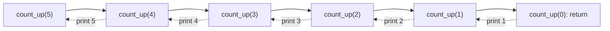

# IFB104 Practice Quiz: Building IT Systems

---

### Question 1

Alice is helping her tutor write a program that converts a student's numeric score into a grade. Before handing it over, she tests it with a score of 90. Here is Alice's code:

```python
score = 90

if score >= 50:
    grade = 'Pass'
if score >= 70:
    grade = 'Credit'
elif score >= 85:
    grade = 'Distinction'
else:
    grade = 'Fail'

print(grade)
```

What is printed when this code runs?

**A.** `Pass`

**B.** `Distinction`

**C.** `Credit`

**D.** `Fail`

**E.** `Pass` then `Credit` on separate lines

---

### Question 2 (multiple answer)

Bob is building a small weather app that suggests what to do for the day, depending on the temperature and whether it is raining. He writes the following function:

```python
def choose_activity(temperature, raining):
    if temperature > 30 or raining and temperature > 20:
        return 'Swim'
    elif not raining:
        return 'Walk'
    else:
        return 'Read'
```

Which of the following function calls return `'Swim'`? Select all that apply.

**A.** `choose_activity(25, False)`

**B.** `choose_activity(35, False)`

**C.** `choose_activity(15, True)`

**D.** `choose_activity(25, True)`

**E.** `choose_activity(20, True)`

---

### Question 3

Charlie is a tutor who has decided to give every student a 10-mark bonus. He writes a small helper function and tests it on a mark of 50:

```python
def add_bonus(score):
    score = score + 10

mark = add_bonus(50)
print(mark)
```

What is printed when this code runs?

**A.** `60`

**B.** `50`

**C.** `None`

**D.** `10`

**E.** `TypeError`

---

### Question 4

Priya is writing a shopping-list app. She writes one function to add an item to the basket, and another to reset the basket by replacing it with a placeholder. She then tests both functions:

```python
def add_item(basket, item):
    basket.append(item)

def replace_basket(basket):
    basket = ['empty']

shopping = ['milk']
add_item(shopping, 'eggs')
replace_basket(shopping)
print(shopping)
```

What is printed when this code runs?

**A.** `['milk']`

**B.** `['empty']`

**C.** `['empty', 'eggs']`

**D.** `['milk', 'eggs']`

**E.** `['eggs']`

---

### Question 5

Minh wants to find out whether a function can change a variable that is passed to it. To make the experiment as clear as possible, he gives the variable and the function's parameter the same name, `a`:

```python
def modify(a):
    a = a + 5

a = 5
modify(a)
print(a)
```

What is printed when this code runs?

**A.** `10`

**B.** `5`

**C.** `None`

**D.** `UnboundLocalError`

**E.** `NameError`

---

### Question 6

Sofia is designing name tags for a conference in Brisbane. She wants to print two short codes taken from different parts of the city's name, so she writes:

```python
city = 'BRISBANE'
print(city[2:5], city[-3:])
```

What is printed when this code runs?

**A.** `RIS NE`

**B.** `ISBA ANE`

**C.** `ISB ANE`

**D.** `RISB ENA`

**E.** `ISB NAB`

---

### Question 7

Alice wants to print every number in her list on a single line. Instead of looping over the list directly, she decides to loop over the index positions and use each position to look up a number:

```python
numbers = [1, 2, 3, 4, 5, 6, 7, 8, 9]

for position in range(1, len(numbers) + 1):
    print(numbers[position], end=' ')
```

What is the result of running this code?

**A.** `1 2 3 4 5 6 7 8 9` is printed and the program ends normally

**B.** `1 2 3 4 5 6 7 8 9` is printed, then an `IndexError` is raised

**C.** `2 3 4 5 6 7 8 9` is printed and the program ends normally

**D.** An `IndexError` is raised before anything is printed

**E.** `2 3 4 5 6 7 8 9` is printed, then an `IndexError` is raised

---

### Question 8

Bob is writing a maths helper for his younger sister. A divisor of a whole number divides into it exactly, with no remainder; for example, the divisors of 6 are 1, 2, 3 and 6. Bob reasons that `number % candidate` is zero exactly when `candidate` divides `number`, so he writes the following function to count the divisors and tests it with 6:

```python
def count_divisors(number):
    count = 0
    for candidate in range(number + 1):
        if number % candidate == 0:
            count = count + 1
    return count

print(count_divisors(6))
```

What is the result of running this code?

**A.** Nothing is printed; a `ZeroDivisionError` is raised

**B.** `4`

**C.** `3`

**D.** `5`

**E.** `0`

---

### Question 9

Priya is organising a pizza night for her study group. There are 19 slices to share between 5 friends, and she wants to know how many whole slices each friend gets and how many are left over. Out of curiosity, she also tries the same operator with a negative number:

```python
slices = 19
friends = 5

print(slices // friends)
print(slices % friends)
print(-17 // 5)
```

What is printed when this code runs?

**A.** `3`, `4` and `-3`

**B.** `4`, `4` and `-3`

**C.** `3.8`, `4` and `-3.4`

**D.** `3`, `4` and `-4`

**E.** `4`, `1` and `-4`

---

### Question 10

Charlie is marking a first-year student's work and finds four lines of code that each crash the program. He runs each line on its own to see which exception it raises:

```python
'3' + 4                 # Line 1
{'apple': 3}['banana']  # Line 2
[10, 20][2]             # Line 3
int('four')             # Line 4
```

Which exception does each line raise, in order from Line 1 to Line 4?

**A.** `ValueError`, `IndexError`, `KeyError`, `TypeError`

**B.** `TypeError`, `IndexError`, `KeyError`, `ValueError`

**C.** `SyntaxError`, `KeyError`, `IndexError`, `TypeError`

**D.** `TypeError`, `KeyError`, `IndexError`, `ValueError`

**E.** `TypeError`, `KeyError`, `IndexError`, `TypeError`

---

### Question 11

Priya is a tutor who keeps her class's results in a list of lists, just like the data in Assignment 1. A student passes only if they score at least 50 in both the exam and the assignment. She writes the following code to list everyone who passed:

```python
results = [['Ana', 72, 85],
           ['Ben', 45, 38],
           ['Cy', 90, 49],
           ['Dee', 50, 50]]
NAME, EXAM, ASSIGNMENT = 0, 1, 2

passed = []
for student in results:
    if student[EXAM] >= 50 and student[ASSIGNMENT] >= 50:
        passed.append(student[NAME])

print(passed)
```

What is printed when this code runs?

**A.** `['Ana', 'Cy', 'Dee']`

**B.** `['Ana', 'Dee']`

**C.** `['Ana']`

**D.** `['Ben', 'Cy']`

**E.** `[['Ana', 72, 85], ['Dee', 50, 50]]`

---

### Question 12

Minh writes a function to add up the prices in a shopping cart, but makes a small typing mistake on the last line of the function without noticing. He then runs his program:

```python
def total_price(prices):
    total = 0
    for price in prices:
        total = total + price
    return totl

print('Start')
result = total_price([2, 3])
print(result)
```

What happens when this program runs?

**A.** A `SyntaxError` is reported and nothing is printed

**B.** A `NameError` is raised before `Start` is printed

**C.** `Start` is printed, then a `NameError` is raised

**D.** `Start` is printed, then `5`

**E.** `Start` is printed, then `None`

---

### Question 13

Sofia is building a sign-up window for her local gym using PySide6. The window needs:

1. a box to type the user's name (one line),
2. an on/off option to subscribe to the newsletter,
3. a choice of exactly one plan (Basic, Pro or Team), with all three options visible at once,
4. a button to submit the form.

Which widgets best match items 1 to 4, in order?

**A.** `QTextEdit`, `QRadioButton`, `QComboBox`, `QLabel`

**B.** `QLineEdit`, `QRadioButton`, `QCheckBox`, `QPushButton`

**C.** `QLabel`, `QCheckBox`, `QListWidget`, `QPushButton`

**D.** `QLineEdit`, `QCheckBox`, `QRadioButton`, `QPushButton`

**E.** `QLineEdit`, `QPushButton`, `QComboBox`, `QLabel`

---

### Question 14

Alice is building a suburb search tool for a real estate agency. She writes the following code to lay out the main window, where `window` is a `QWidget`:

```python
main_layout = QVBoxLayout()

search_row = QHBoxLayout()
search_row.addWidget(QLabel('Suburb:'))
search_row.addWidget(QComboBox())

main_layout.addLayout(search_row)
main_layout.addWidget(QPushButton('Search'))
main_layout.addWidget(QLabel('Results'))

window.setLayout(main_layout)
```

Which sketch best shows the resulting window?

<table>
<tr>
<td valign="top">

<b>A.</b>

```text
+------------------------------------+
| Suburb:  [ combo box        v ]    |
| [            Search            ]   |
| Results                            |
+------------------------------------+
```

</td>
<td valign="top">

<b>B.</b>

```text
+------------------------------------+
| Suburb: [combo v] [Search] Results |
+------------------------------------+
```

</td>
</tr>
<tr>
<td valign="top">

<b>C.</b>

```text
+------------------------------------+
| Suburb:                            |
| [ combo box                  v ]   |
| [            Search            ]   |
| Results                            |
+------------------------------------+
```

</td>
<td valign="top">

<b>D.</b>

```text
+------------------------------------+
| [            Search            ]   |
| Results                            |
| Suburb:  [ combo box        v ]    |
+------------------------------------+
```

</td>
</tr>
<tr>
<td valign="top">

<b>E.</b>

```text
+------------------------------------+
| Suburb:         | [ Search ]       |
| [ combo   v ]   | Results          |
+------------------------------------+
```

</td>
</tr>
</table>

---

### Question 15

Bob adds a button to his first Qt program and wants a message to be printed every time the button is clicked. He writes:

```python
def show_message():
    print('Button clicked!')

button = QPushButton('Click me')
button.clicked.connect(show_message())
```

What happens when the last line runs?

**A.** Nothing happens yet; `Button clicked!` is printed each time the user clicks the button

**B.** `Button clicked!` is printed once straight away, then `connect` raises a `TypeError` because it was given `None`

**C.** Nothing is ever printed, but no error occurs

**D.** A `SyntaxError` is reported because `connect` needs a string

**E.** `Button clicked!` is printed twice on every click

---

### Question 16

Charlie runs a small online bakery where every cupcake costs $2, and writes a GUI to calculate the cost of an order. A customer types `4` into `quantity_input` (a `QLineEdit`) and clicks the button connected to this function:

```python
def show_total():
    quantity = quantity_input.text()
    price_per_item = 2
    total = quantity * price_per_item
    result_label.setText('Total: ' + str(total))
```

What does `result_label` display?

**A.** `Total: 8`

**B.** Nothing; a `TypeError` is raised

**C.** `Total: 4`

**D.** Nothing; a `ValueError` is raised

**E.** `Total: 44`

---

### Question 17

Priya is writing a script to pick out QUT student IDs from a long file of emails. A QUT student ID is the lowercase letter `n` followed by exactly eight digits, for example `n12345678`, and must appear as a complete token, not embedded in other characters.

Which regex pattern should Priya use?

**A.** `n\d+`

**B.** `\bn\d{8}`

**C.** `\bn\d{8}\b`

**D.** `[n]\d{7}\b`

**E.** `\bN\d{8}\b`

---

### Question 18

Minh is given a note describing where a meeting will be held, and wants to pull out every number in it. He writes:

```python
import re

print(re.findall(r"\d+", "Room 12, level 3, 2026"))
```

What is printed when this code runs?

**A.** `[12, 3, 2026]`

**B.** `['1', '2', '3', '2', '0', '2', '6']`

**C.** `'12'`

**D.** `['12', '3', '2026']`

**E.** `['Room 12', 'level 3', '2026']`

---

### Question 19 (multiple answer)

Sofia manages a warehouse where every product code must be exactly two uppercase letters followed by exactly three digits. She checks each code that staff type in using `re.fullmatch(pattern, text)` with the pattern below:

```python
import re

pattern = r"[A-Z]{2}\d{3}"
```

For which of the following values of `text` does `re.fullmatch` return a match? Select all that apply.

**A.** `'AB123'`

**B.** `'ab123'`

**C.** `'AB1234'`

**D.** `'XY000'`

**E.** `'A B123'`

---

### Question 20\* (multiple answer)

Alice's lecturer sets the class a challenge: print the numbers 1 to 5 in ascending order, one per line, **without using any loop**. Alice and her classmates submit the five programs below, all using a recursive function. Which of them meet the challenge? Select all that apply.

<table>
<tr>
<td valign="top">

<b>A.</b>

```python
def count_up(number):
    if number > 5:
        return
    print(number)
    count_up(number + 1)

count_up(1)
```

</td>
<td valign="top">

<b>B.</b>

```python
def count_up(number):
    if number > 5:
        return
    count_up(number + 1)
    print(number)

count_up(1)
```

</td>
</tr>
<tr>
<td valign="top">

<b>C.</b>

```python
def count_up(number):
    print(number)
    count_up(number + 1)

count_up(1)
```

</td>
<td valign="top">

<b>D.</b>

```python
def count_up(number):
    if number == 0:
        return
    count_up(number - 1)
    print(number)

count_up(5)
```

</td>
</tr>
<tr>
<td valign="top">

<b>E.</b>

```python
def count_up(number):
    if number < 5:
        print(number)
        count_up(number + 1)

count_up(1)
```

</td>
</tr>
</table>

---

### Question 21

Before submitting his assignment, Bob's tutor asks him to tidy up his code so that it follows the IFB104 Code Presentation Guide. His classmates each suggest a different way of converting minutes into seconds. Which suggestion best follows the guide?

<table>
<tr>
<td valign="top">

<b>A.</b>

```python
for i in range(len(minute_list)):
    second_list.append(minute_list[i] * 60)
```

</td>
<td valign="top">

<b>B.</b>

```python
SECONDS_PER_MINUTE = 60
total_seconds = minutes * SECONDS_PER_MINUTE
```

</td>
</tr>
<tr>
<td valign="top">

<b>C.</b>

```python
x = m*60 # multiply m by 60
```

</td>
<td valign="top">

<b>D.</b>

```python
def Calc(m): return m*60
```

</td>
</tr>
<tr>
<td valign="top">

<b>E.</b>

```python
totSecs = mins * 60 # calc secs
```

</td>
</tr>
</table>

---

### Question 22\*

Charlie is studying the Fibonacci sequence `0, 1, 1, 2, 3, 5, 8, 13, ...`, in which each term is the sum of the two terms before it. He stores each term in a list so that every new term can be built from the two before it. His function is meant to return term `n`, counting from 0, so `fibonacci(6)` should return `8`:

```python
def fibonacci(n):
    fibo = [0] * n
    fibo[0] = 0
    fibo[1] = 1
    for index in range(2, n + 1):
        fibo[index] = fibo[index - 1] + fibo[index - 2]
    return fibo[n]

print(fibonacci(6))
```

What happens when this code runs, and what is the best fix?

**A.** It prints `8`; no fix is needed

**B.** It prints `5`; change the return statement to `return fibo[n + 1]`

**C.** It raises an `IndexError`; change the first line to `fibo = [0] * (n + 1)`

**D.** It raises an `IndexError`; change the loop to `range(2, n)` and leave everything else as it is

**E.** It loops forever; add a `break` inside the loop

<!-- SOLUTIONS -->

---

# Solutions and Explanations

## Quick Answer Key

| Q | Answer | Q | Answer | Q | Answer |
|:-:|:------:|:-:|:------:|:-:|:------:|
| 1 | C | 9 | D | 17 | C |
| 2 | B, D | 10 | D | 18 | D |
| 3 | C | 11 | B | 19 | A, D |
| 4 | D | 12 | C | 20 | A, D |
| 5 | B | 13 | D | 21 | B |
| 6 | C | 14 | A | 22 | C |
| 7 | E | 15 | B |  |  |
| 8 | A | 16 | E |  |  |

---

### Q1: **C** `Credit`

There are **two separate `if` statements**, not one chain.

1. `score >= 50` is `True`, so `grade = 'Pass'`.
2. A *new* chain starts: `score >= 70` is `True`, so `grade = 'Credit'`, and the `elif`/`else` are skipped.

The `elif score >= 85` branch can **never** run: any score that is at least 85 is also at least 70, so the first branch always catches it. Put the strictest test first:

```python
if score >= 85:
    grade = 'Distinction'
elif score >= 70:
    grade = 'Credit'
elif score >= 50:
    grade = 'Pass'
else:
    grade = 'Fail'
```

### Q2: **B, D**

`and` binds tighter than `or`, so the condition reads as:

```python
temperature > 30 or (raining and temperature > 20)
```

| Call | `temp > 30` | `raining and temp > 20` | Result |
|---|---|---|---|
| A `(25, False)` | False | False | `not raining`, so **Walk** |
| B `(35, False)` | **True** | n/a | **Swim** |
| C `(15, True)` | False | False | **Read** |
| D `(25, True)` | False | **True** | **Swim** |
| E `(20, True)` | False | False (`20 > 20` is False) | **Read** |

E is the boundary trap: `>` is not `>=`.

### Q3: **C** `None`

`add_bonus` calculates `60` and stores it in its local variable `score`, but it has **no `return` statement**. A function without a `return` gives back `None`, so `mark = add_bonus(50)` stores `None`. The fix is to return the result:

```python
def add_bonus(score):
    return score + 10
```

### Q4: **D** `['milk', 'eggs']`

- `add_item` calls `.append()` on the list object, which **changes the shared list** that `shopping` also refers to.
- `replace_basket` only **rebinds the local name** `basket` to a new list, so the caller's list is untouched.

> [!TIP]
> **Rule of thumb:** *mutating* a list (`append`, `remove`, `basket[0] = ...`) is visible to the caller. *Reassigning* the parameter (`basket = ...`) is not.

### Q5: **B** `5`

Using the same name does **not** link the two variables. The parameter `a` is a separate **local** variable that starts off referring to the same value, `5`.

1. Inside `modify`, `a = a + 5` makes the *local* `a` refer to `10`.
2. When the function ends, the local `a` disappears.
3. The outer `a` was never reassigned, so it is still `5`.

Integers are **immutable**, so a function can never change the caller's integer; it can only **return** a new value. To keep the change:

```python
def modify(a):
    return a + 5

a = modify(a)   # a is now 10
```

There is no `UnboundLocalError`, because `a` already has a value as a parameter when `a + 5` is calculated.

### Q6: **C** `ISB ANE`

| Index | 0 | 1 | 2 | 3 | 4 | 5 | 6 | 7 |
|---|---|---|---|---|---|---|---|---|
| Letter | B | R | **I** | **S** | **B** | A | N | E |
| Negative | -8 | -7 | -6 | -5 | -4 | **-3** | **-2** | **-1** |

- `city[2:5]` starts at index 2 and stops **before** index 5, giving `ISB`.
- `city[-3:]` starts 3 from the end and runs to the end, giving `ANE`.

### Q7: **E**

There are two off-by-one mistakes:

1. The range **starts at 1**, so `numbers[0]` (the value `1`) is skipped.
2. The range **ends at `len(numbers)`**, which is 9, but the last valid index is 8.

So the loop prints `numbers[1]` to `numbers[8]` (that is, `2 3 4 5 6 7 8 9`), then `numbers[9]` raises `IndexError: list index out of range`. Lines run one at a time, so the output printed before the error still appears. The Pythonic fix avoids the index variable altogether:

```python
for number in numbers:
    print(number, end=' ')
```

### Q8: **A** `ZeroDivisionError`

`range(number + 1)` starts at **0**, so the very first test is `6 % 0`. The remainder operator divides, so dividing by zero raises a `ZeroDivisionError` before `count` is ever increased or returned, and nothing is printed. The fix is to start the range at 1:

```python
for candidate in range(1, number + 1):
```

With this change, `count_divisors(6)` returns `4` (for 1, 2, 3 and 6).

### Q9: **D** `3`, `4`, `-4`

`//` is **floor division**: it divides, then rounds **down** to the nearest whole number. It never rounds to the *nearest* number.

| Expression | Exact value | Result | Why |
|---|---|---|---|
| `19 // 5` | 3.8 | `3` | rounded **down**, not up to 4 |
| `19 % 5` | n/a | `4` | the remainder: `5 * 3 + 4 = 19` |
| `-17 // 5` | -3.4 | `-4` | "down" means towards **negative infinity**, so -3.4 goes to -4, not -3 |

- **A** is what you'd get by chopping off the decimal part, which is what `int(-17 / 5)` does (`-3`).
- **B** is what you'd get by rounding to the nearest whole number.
- **C** uses `/`, which always gives a `float`, even for `20 / 5` (`4.0`).

> [!NOTE]
> Python's `round()` rounds halves to the nearest **even** number, so `round(2.5)` is `2` but `round(3.5)` is `4`.

### Q10: **D**

| Line | Error | Why |
|---|---|---|
| `'3' + 4` | `TypeError` | can't add a `str` and an `int` |
| `{'apple': 3}['banana']` | `KeyError` | key not in dictionary |
| `[10, 20][2]` | `IndexError` | valid indices are only 0 and 1 |
| `int('four')` | `ValueError` | right type (`str`), but the value can't become an int |

> [!TIP]
> **TypeError** = wrong *kind* of thing. **ValueError** = right kind, bad *content*.

### Q11: **B** `['Ana', 'Dee']`

| Student | Exam >= 50 | Assignment >= 50 | Passed? |
|---|---|---|---|
| Ana | 72: yes | 85: yes | **yes** |
| Ben | 45: no | 38: no | no |
| Cy | 90: yes | 49: no | no (`and` needs both) |
| Dee | 50: yes | 50: yes | **yes** (`>=` includes 50) |

Only `student[NAME]` is appended, so the list holds names, not whole records (option E). Option A forgets that `and` needs both conditions, and option C treats `>=` as `>`.

### Q12: **C**

The typo `totl` is a perfectly valid *name*, so there is **no SyntaxError**. Python only looks a name up when that line **runs**. `Start` prints first, then calling `total_price` reaches `return totl` and raises `NameError: name 'totl' is not defined`.

> [!IMPORTANT]
> **SyntaxError**: caught *before* anything runs (e.g. missing `:`). **NameError / TypeError / IndexError / ...**: raised *while* running, only on the line that triggers them.

### Q13: **D**

| Need | Widget | Why |
|---|---|---|
| one-line name | `QLineEdit` | single-line text input (`QTextEdit` is multi-line) |
| on/off newsletter | `QCheckBox` | independent yes/no toggle |
| exactly one plan, all visible | `QRadioButton` ×3 | mutually exclusive, all shown at once |
| submit | `QPushButton` | emits `clicked` |

Option **B** swaps checkbox and radio button: the classic trap. (A `QComboBox` also picks one option, but it **hides** the list until opened.)

### Q14: **A**

- `QVBoxLayout` stacks items **top to bottom** in the order they're added.
- The first item added is the `search_row` (a `QHBoxLayout`), which places `Suburb:` and the combo box **side by side**.
- Then come the `Search` button and the `Results` label underneath.

**C** would be the result if the label and combo box were added straight to `main_layout`. **D** gets the order wrong.

### Q15: **B**

`show_message()` **with parentheses calls the function right now**. It prints once and returns `None`, so the line becomes `button.clicked.connect(None)`, and PySide6 raises `TypeError: Expected signal or callable, got "NoneType"`.

```python
button.clicked.connect(show_message)   # correct: pass the function itself, no ()
```

> [!WARNING]
> This is one of the most common Qt mistakes. If the slot needs arguments, use a `lambda`: `button.clicked.connect(lambda: show_message('Hi'))`.

### Q16: **E** `Total: 44`

`QLineEdit.text()` **always returns a string**. `'4' * 2` is **string repetition**, giving `'44'`. No error is raised, so the bug is silent. Convert first:

```python
quantity = int(quantity_input.text())   # wrap in try/except ValueError for bad input
```

> [!NOTE]
> If the price were `2.5`, `'4' * 2.5` *would* raise a `TypeError`. The bug is only silent because `2` is an integer.

### Q17: **C** `\bn\d{8}\b`

- **A** `n\d+`: any number of digits, so it accepts `n1`, and it also matches inside words.
- **B** is missing the closing `\b`, so `n123456789` matches its first 8 digits.
- **C** (correct): lowercase `n`, exactly 8 digits, a word boundary on each side.
- **D** has only 7 digits.
- **E** uses uppercase `N`. Regex is case-sensitive by default.

### Q18: **D** `['12', '3', '2026']`

`findall` returns a **list of strings** (never ints, so A is wrong). `\d+` is greedy and takes the **longest run** of digits each time, so `12` stays together (B would be `\d` without the `+`).

### Q19: **A, D**

`fullmatch` requires the **whole string** to match: exactly 2 uppercase letters, then exactly 3 digits.

- `'AB123'`: matches
- `'ab123'`: no match, lowercase
- `'AB1234'`: no match, one digit too many (plain `re.search` *would* find `AB123` inside it)
- `'XY000'`: matches
- `'A B123'`: no match, the space breaks it

> [!TIP]
> Use `fullmatch` (or `^...$`) to **validate** input, and `search` / `findall` to **find** things inside longer text.

### Q20: **A, D**

- **A** (correct) prints *before* recursing: 1, 2, 3, 4, 5. The base case stops at 6.
- **B** (wrong) prints *after* recursing, so the output **unwinds backwards**: 5, 4, 3, 2, 1.
- **C** (wrong) has **no base case**: prints 1, 2, 3, ... until `RecursionError`.
- **D** (correct) counts *down* to 0 first and prints on the way **back up**: 1, 2, 3, 4, 5.
- **E** (wrong) off-by-one: `number < 5` stops before printing 5, so it prints 1 to 4.



> [!IMPORTANT]
> Every recursive function needs: (1) a **base case** that stops, and (2) a recursive call that **moves toward** it.

### Q21: **B**

B uses a **named constant** instead of a magic number, has meaningful names and has spaces around operators.

- **A**: unnecessary single-letter index loop (the guide says to loop over the list directly, e.g. `for minutes in minute_list:`), plus the magic number `60`.
- **C**: meaningless names, no spaces around `*`, and a comment that just repeats the code.
- **D**: the name isn't a descriptive verb, the parameter name is a single letter, `60` is a magic number, and it's crammed onto one line.
- **E**: abbreviations (`totSecs`, `calc`), which the guide says to avoid.

### Q22: **C**

`fibo = [0] * 6` has indices `0..5`, but the loop goes up to `index = 6` (and the function returns `fibo[6]`), so `fibo[6] = ...` raises `IndexError`. To store terms 0 to `n` you need **`n + 1`** slots:

```python
def fibonacci(n):
    fibo = [0] * (n + 1)
    fibo[0] = 0
    fibo[1] = 1
    for index in range(2, n + 1):
        fibo[index] = fibo[index - 1] + fibo[index - 2]
    return fibo[n]

print(fibonacci(6))  # -> 8
```

| index | 0 | 1 | 2 | 3 | 4 | 5 | 6 |
|---|---|---|---|---|---|---|---|
| fibo | 0 | 1 | 1 | 2 | 3 | 5 | **8** |

Option **D** fixes the loop but `return fibo[n]` still reads `fibo[6]`, so it **still** raises `IndexError`.
