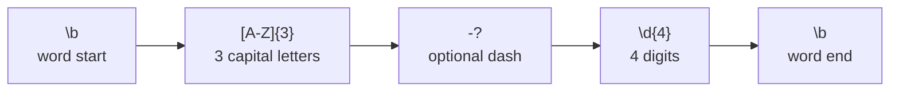
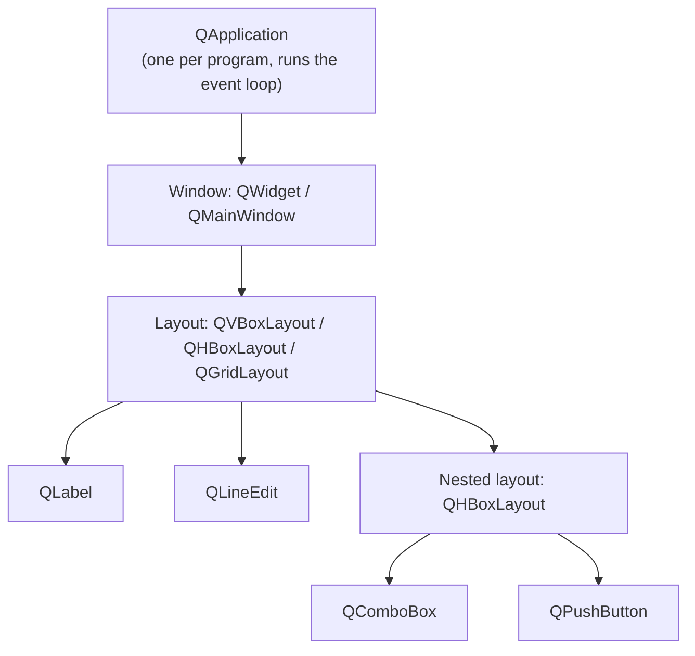
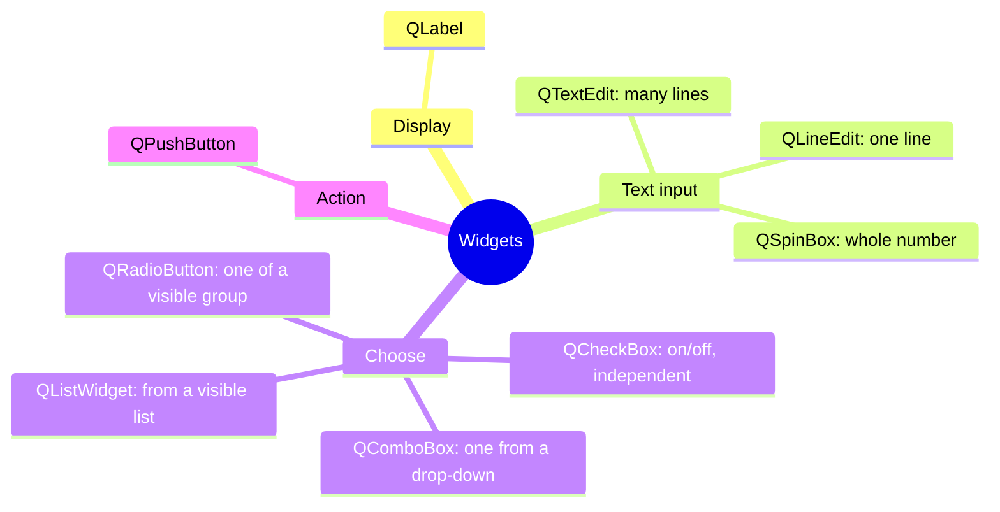
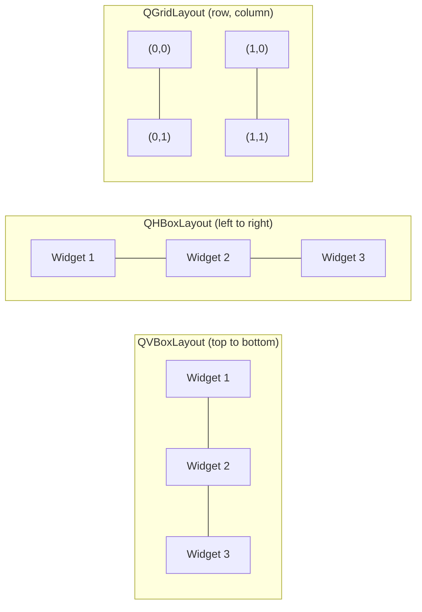

# IFB104 Quick Revision: Regex and PySide6/Qt

- [Part 1: Regex patterns](#part-1-regex-patterns)
- [Part 2: PySide6/Qt components](#part-2-pyside6qt-components)

---

## Part 1: Regex Patterns

> For ready-made patterns (email, phone, dates...) see [common_pattern_regex.md](common_pattern_regex.md). This part covers the **building blocks** you combine to make them.

### 1.1 Characters and classes

| Pattern | Matches | Example | Matches in `"Ab 3_!"` |
|---|---|---|---|
| `a` | the literal character `a` | `cat` | none |
| `.` | **any** character except newline | `c.t` | every character |
| `\d` | a digit `0-9` | `\d\d` | `3` |
| `\D` | a **non**-digit | | `A`, `b`, ` `, `_`, `!` |
| `\w` | word character: letter, digit or `_` | | `A`, `b`, `3`, `_` |
| `\W` | **non**-word character | | ` `, `!` |
| `\s` | whitespace (space, tab, newline) | | ` ` |
| `\S` | **non**-whitespace | | everything except ` ` |
| `[abc]` | **one** of `a`, `b`, `c` | `gr[ae]y` | |
| `[a-z]` | one character in a range | `[A-Z]` | `A` |
| `[^abc]` | one character **not** in the set | `[^0-9]` | |
| `\.` `\$` `\(` | escaped special character, matched literally | `\.com` | |

> Capital letter = opposite: `\d`/`\D`, `\w`/`\W`, `\s`/`\S`.

### 1.2 Quantifiers: *how many?*

| Pattern | Meaning | Example | Matches |
|---|---|---|---|
| `*` | 0 or more | `ab*` | `a`, `ab`, `abbb` |
| `+` | 1 or more | `ab+` | `ab`, `abbb` (not `a`) |
| `?` | 0 or 1 (optional) | `colou?r` | `color`, `colour` |
| `{n}` | exactly n | `\d{4}` | `2026` |
| `{n,}` | n or more | `\d{2,}` | `12`, `12345` |
| `{n,m}` | between n and m | `\d{1,3}` | `7`, `42`, `255` |
| `*?` `+?` | **lazy**: as few as possible | `<.+?>` | `<b>` rather than `<b>bold</b>` |

> Quantifiers are **greedy** by default: they grab as much as they can.

### 1.3 Anchors and boundaries: *where?*

| Pattern | Meaning | Example |
|---|---|---|
| `^` | start of string | `^Hello` |
| `$` | end of string | `\.txt$` |
| `\b` | word boundary (edge between `\w` and non-`\w`) | `\bcat\b` matches `cat` but not inside `category` |
| `\B` | **not** a word boundary | `\Bcat` matches inside `bobcat` |

### 1.4 Groups and alternation

| Pattern | Meaning | Example |
|---|---|---|
| `a\|b` | `a` **or** `b` | `cat\|dog` |
| `( ... )` | capturing group: grouping **and** remembering | `(\d{2}):(\d{2})` |
| `(?: ... )` | non-capturing group: grouping only | `(?:ab)+` |
| `\1` | back-reference to group 1 | `\b(\w+)\s+\1\b` matches `the the` |
| `X(?=Y)` | X **followed by** Y (lookahead) | `\w+(?=@)` |
| `X(?!Y)` | X **not** followed by Y | |
| `(?<=Y)X` | X **preceded by** Y (lookbehind) | `(?<=\$)\d+` |
| `(?<!Y)X` | X **not** preceded by Y | |

### 1.5 Python `re` functions

| Function | Returns | Use it to... |
|---|---|---|
| `re.search(p, s)` | first `Match` **anywhere**, or `None` | find whether something appears |
| `re.match(p, s)` | `Match` only at the **start**, or `None` | check a prefix |
| `re.fullmatch(p, s)` | `Match` only if the **whole** string matches | **validate** input |
| `re.findall(p, s)` | **list of strings** (or tuples of groups) | extract every match |
| `re.sub(p, new, s)` | new string | find and replace |

```python
import re

text = "Lecture at 09:30, lab at 14:00"

re.findall(r"\d{2}:\d{2}", text)          # ['09:30', '14:00']
re.findall(r"(\d{2}):(\d{2})", text)      # [('09', '30'), ('14', '00')]  <- groups give tuples
re.search(r"\d{2}:\d{2}", text).group()   # '09:30'
bool(re.fullmatch(r"\d{2}:\d{2}", text))  # False (the whole string isn't a time)
re.sub(r"\d{2}:\d{2}", "TBA", text)       # 'Lecture at TBA, lab at TBA'
```

### 1.6 Common traps

1. **Always use raw strings** `r"..."`. Without the `r`, Python turns `"\b"` into a backspace character.
2. `findall` returns **strings**: convert with `int()` before doing maths.
3. With **groups**, `findall` returns only the group contents. Use `(?:...)` if you just need grouping.
4. `search` vs `fullmatch`: `re.search(r"\d{4}", "123456")` **succeeds** (finds `1234`). Use `fullmatch` or `^...$` / `\b...\b` to validate.
5. `.` matches *anything*. To match a real dot, write `\.`.
6. `search` returns `None` when nothing matches, so `.group()` on `None` raises an **AttributeError**. Check first:

```python
match = re.search(r"\bn\d{8}\b", text)
if match:
    print(match.group())
```

### 1.7 Reading a pattern: worked example



`\b[A-Z]{3}-?\d{4}\b`: matches `ABC-1234` and `XYZ9876`; does not match `IFB104` (only 3 digits), `abc1234` (lowercase) or `ABC12345` (5 digits, so there's no word boundary after the 4th)

---

## Part 2: PySide6/Qt Components

### 2.1 The big picture

Every PySide6 program has the same skeleton: **one** `QApplication`, a top-level **window**, a **layout** that arranges **widgets**, and **signals** connected to **slots** (your functions).



```python
import sys
from PySide6.QtWidgets import (QApplication, QWidget, QVBoxLayout,
                               QLabel, QLineEdit, QPushButton)

def greet_user():
    name = name_input.text()
    greeting_label.setText('Hello, ' + name + '!')

app = QApplication(sys.argv)                # 1. the application

window = QWidget()                          # 2. the window
window.setWindowTitle('Greeter')

name_input = QLineEdit()                    # 3. the widgets
greet_button = QPushButton('Greet')
greeting_label = QLabel('')

layout = QVBoxLayout()                      # 4. the layout
layout.addWidget(name_input)
layout.addWidget(greet_button)
layout.addWidget(greeting_label)
window.setLayout(layout)

greet_button.clicked.connect(greet_user)    # 5. signal -> slot (no brackets!)

window.show()                               # 6. show it
sys.exit(app.exec())                        # 7. start the event loop
```

### 2.2 Event loop: how a click becomes code

```mermaid
sequenceDiagram
    actor User
    participant Loop as QApplication event loop
    participant Button as QPushButton
    participant Slot as greet_user()
    participant Label as QLabel

    User->>Button: clicks
    Button->>Loop: emits clicked signal
    Loop->>Slot: calls the connected function
    Slot->>Slot: name_input.text() returns str
    Slot->>Label: setText('Hello, ...')
    Label-->>User: window repaints
    Note over Loop: waits for the next event...
```

> Nothing happens until `app.exec()` runs. After that your code only runs **in response to signals**.

### 2.3 Widget cheat sheet



| Widget | Use for | Read value | Set value | Key signal |
|---|---|---|---|---|
| `QLabel` | showing text / images | `.text()` | `.setText(str)` | n/a |
| `QLineEdit` | one line of input | `.text()` returns **str** | `.setText(str)`, `.clear()` | `textChanged`, `returnPressed` |
| `QTextEdit` | multi-line input | `.toPlainText()` | `.setPlainText(str)` | `textChanged` |
| `QPushButton` | triggering an action | n/a | `.setText(str)` | **`clicked`** |
| `QCheckBox` | independent yes/no | `.isChecked()` returns **bool** | `.setChecked(bool)` | `stateChanged`, `toggled` |
| `QRadioButton` | one of several, all visible | `.isChecked()` | `.setChecked(bool)` | `toggled` |
| `QComboBox` | one of several, drop-down | `.currentText()`, `.currentIndex()` | `.addItem(str)`, `.addItems(list)` | `currentTextChanged`, `currentIndexChanged` |
| `QListWidget` | pick from visible list | `.currentItem().text()` | `.addItem(str)` | `itemClicked`, `currentRowChanged` |
| `QSpinBox` | whole number in a range | `.value()` returns **int** | `.setValue(int)`, `.setRange(lo, hi)` | `valueChanged` |

### 2.4 Layouts



| Method | Purpose |
|---|---|
| `layout.addWidget(widget)` | add a widget to a box layout |
| `grid.addWidget(widget, row, column)` | place a widget in a grid cell |
| `layout.addLayout(other_layout)` | **nest** one layout inside another |
| `window.setLayout(layout)` | attach the top-level layout to the window |

### 2.5 Qt traps that show up in exams

| Trap | Fix | Why |
|---|---|---|
| `button.clicked.connect(do_it())` | `button.clicked.connect(do_it)` | brackets **call** it now and pass `None` |
| `total = box.text() * 2` | `total = int(box.text()) * 2` | `.text()` is a **str**: `'4' * 2` is `'44'` |
| `label.setText(42)` | `label.setText(str(42))` | `setText` needs a **str** (`TypeError` otherwise) |
| `int(box.text())` with blank or `'abc'` | wrap in `try` / `except ValueError` | defensive coding |
| `checkbox.isChecked` | `checkbox.isChecked()` | without `()` it's the method itself, which is always truthy |
| plans as `QCheckBox` | `QRadioButton` | checkboxes allow **many**; radios allow **one** |
| forgetting `window.setLayout(layout)` | add it | widgets won't be arranged in the window |
| forgetting `app.exec()` | add it | the window flashes and the program ends |

```python
def show_total():
    try:
        quantity = int(quantity_input.text())
        result_label.setText('Total: $' + str(quantity * PRICE_PER_ITEM))
    except ValueError:
        result_label.setText('Please enter a whole number')
```
