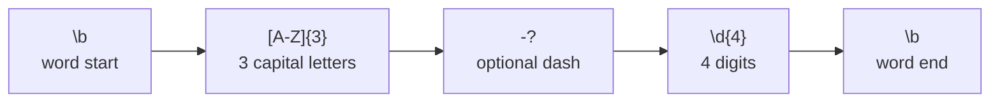
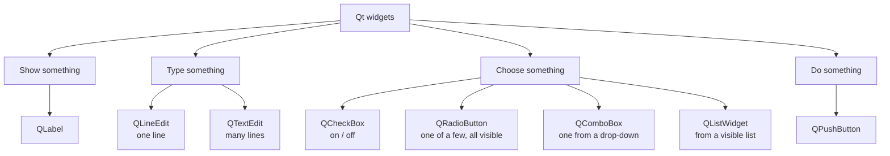

# IFB104 Quick Revision: Regex and PySide6/Qt

- [Part 1: Regex patterns](#part-1-regex-patterns)
- [Part 2: PySide6/Qt components](#part-2-pyside6qt-components)

---

## Part 1: Regex Patterns

> [!NOTE]
> For ready-made patterns (email, phone, dates...) see [common_pattern_regex.md](common_pattern_regex.md). This part covers the **building blocks** you combine to make them.

### 1.1 Characters and classes

| Pattern | Matches | Example | Matches in `"Ab 3_!"` |
|---|---|---|---|
| `a` | the literal character `a` | `cat` | none |
| `.` | **any** character except newline | `c.t` | every character |
| `\d` | a digit `0-9` | `\d\d` | `3` |
| `\D` | a **non**-digit | | `A`, `b`, ` `, `_`, `!` |
| `\w` | word character: letter, digit or `_` | | `A`, `b`, `3`, `_` |
| `\W` | **non**-word character | | ` `, `!` |
| `\s` | whitespace (space, tab, newline) | | ` ` |
| `\S` | **non**-whitespace | | everything except ` ` |
| `[abc]` | **one** of `a`, `b`, `c` | `gr[ae]y` | |
| `[a-z]` | one character in a range | `[A-Z]` | `A` |
| `[^abc]` | one character **not** in the set | `[^0-9]` | |
| `\.` `\$` `\(` | escaped special character, matched literally | `\.com` | |

> [!TIP]
> Capital letter = opposite: `\d`/`\D`, `\w`/`\W`, `\s`/`\S`.

### 1.2 Quantifiers: *how many?*

| Pattern | Meaning | Example | Matches |
|---|---|---|---|
| `*` | 0 or more | `ab*` | `a`, `ab`, `abbb` |
| `+` | 1 or more | `ab+` | `ab`, `abbb` (not `a`) |
| `?` | 0 or 1 (optional) | `colou?r` | `color`, `colour` |
| `{n}` | exactly n | `\d{4}` | `2026` |
| `{n,}` | n or more | `\d{2,}` | `12`, `12345` |
| `{n,m}` | between n and m | `\d{1,3}` | `7`, `42`, `255` |
| `*?` `+?` | **lazy**: as few as possible | `<.+?>` | `<b>` rather than `<b>bold</b>` |

> [!WARNING]
> Quantifiers are **greedy** by default: they grab as much as they can.

### 1.3 Anchors and boundaries: *where?*

| Pattern | Meaning | Example |
|---|---|---|
| `^` | start of string | `^Hello` |
| `$` | end of string | `\.txt$` |
| `\b` | word boundary (edge between `\w` and non-`\w`) | `\bcat\b` matches `cat` but not inside `category` |
| `\B` | **not** a word boundary | `\Bcat` matches inside `bobcat` |

### 1.4 Groups and alternation

| Pattern | Meaning | Example |
|---|---|---|
| `a\|b` | `a` **or** `b` | `cat\|dog` |
| `( ... )` | capturing group: grouping **and** remembering | `(\d{2}):(\d{2})` |
| `(?: ... )` | non-capturing group: grouping only | `(?:ab)+` |
| `\1` | back-reference to group 1 | `\b(\w+)\s+\1\b` matches `the the` |
| `X(?=Y)` | X **followed by** Y (lookahead) | `\w+(?=@)` |
| `X(?!Y)` | X **not** followed by Y | |
| `(?<=Y)X` | X **preceded by** Y (lookbehind) | `(?<=\$)\d+` |
| `(?<!Y)X` | X **not** preceded by Y | |

### 1.5 Python `re` functions

| Function | Returns | Use it to... |
|---|---|---|
| `re.search(p, s)` | first `Match` **anywhere**, or `None` | find whether something appears |
| `re.match(p, s)` | `Match` only at the **start**, or `None` | check a prefix |
| `re.fullmatch(p, s)` | `Match` only if the **whole** string matches | **validate** input |
| `re.findall(p, s)` | **list of strings** (or tuples of groups) | extract every match |
| `re.sub(p, new, s)` | new string | find and replace |

```python
import re

text = "Lecture at 09:30, lab at 14:00"

re.findall(r"\d{2}:\d{2}", text)          # ['09:30', '14:00']
re.findall(r"(\d{2}):(\d{2})", text)      # [('09', '30'), ('14', '00')]  <- groups give tuples
re.search(r"\d{2}:\d{2}", text).group()   # '09:30'
bool(re.fullmatch(r"\d{2}:\d{2}", text))  # False (the whole string isn't a time)
re.sub(r"\d{2}:\d{2}", "TBA", text)       # 'Lecture at TBA, lab at TBA'
```

### 1.6 Common traps

1. **Always use raw strings** `r"..."`. Without the `r`, Python turns `"\b"` into a backspace character.
2. `findall` returns **strings**: convert with `int()` before doing maths.
3. With **groups**, `findall` returns only the group contents. Use `(?:...)` if you just need grouping.
4. `search` vs `fullmatch`: `re.search(r"\d{4}", "123456")` **succeeds** (finds `1234`). Use `fullmatch` or `^...$` / `\b...\b` to validate.
5. `.` matches *anything*. To match a real dot, write `\.`.
6. `search` returns `None` when nothing matches, so `.group()` on `None` raises an **AttributeError**. Check first:

```python
match = re.search(r"\bn\d{8}\b", text)
if match:
    print(match.group())
```

### 1.7 Reading a pattern: worked example



`\b[A-Z]{3}-?\d{4}\b`: matches `ABC-1234` and `XYZ9876`; does not match `IFB104` (only 3 digits), `abc1234` (lowercase) or `ABC12345` (5 digits, so there's no word boundary after the 4th)

---

## Part 2: PySide6/Qt Components

A Qt window is built from **widgets**: the boxes, buttons and labels the user sees and interacts with. Pick the widget that matches what the user needs to do.



### QLabel: show text

Displays text that the user can read but not edit, such as a title, an instruction or a result.

```python
result_label.setText('Total: $8')
```

### QLineEdit: a one-line text box

The box you type a name, a number or a **search term** into. `.text()` always returns a **string**, so convert it with `int()` or `float()` before doing maths.

```python
search_term = search_input.text()
```

### QTextEdit: a multi-line text box

Like `QLineEdit`, but for longer text such as comments or a message. Read it with `.toPlainText()`.

### QCheckBox: an on/off option

A tick box for a yes/no choice, such as "Subscribe to newsletter". Each checkbox is **independent**, so the user can tick as many as they like.

```python
if newsletter_checkbox.isChecked():
    ...
```

### QRadioButton: pick exactly one

A small group of round buttons where choosing one **unticks the others**, such as Basic / Pro / Team. Use it when there are only a few options and you want them all **visible at once**.

### QComboBox: a drop-down list

Picks **one** option from a list that stays hidden until the user opens it, such as choosing a suburb. Good when there are many options and not much space.

```python
suburb = suburb_combo.currentText()
```

### QListWidget: a visible list

Shows the whole list on screen, such as search results, and lets the user click an item.

### QPushButton: do something

A button the user clicks to make something happen. Connect its `clicked` signal to your function, **without brackets**:

```python
search_button.clicked.connect(run_search)
```

> [!TIP]
> - **Checkbox or radio button?** Checkboxes allow **many** choices; radio buttons allow **one**.
> - **Radio button or combo box?** Both pick one option. Radio buttons show every option, while a combo box hides them in a drop-down.
